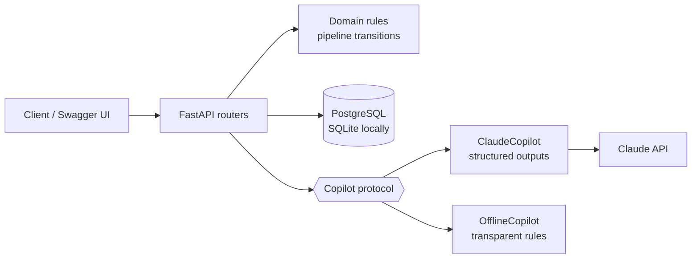

# LeadPilot

[](https://github.com/BrahimNJ/LeadPilot/actions/workflows/ci.yml)


A small CRM with an AI copilot for B2B sales teams.

Track companies, contacts and deals, log every interaction, and ask the copilot three
things a salesperson needs every morning: **who should I call first, where does this
relationship stand, and what do I write next?**

## What it does

| | |
|---|---|
| **Contacts & companies** | CRUD, search by name or email, unique emails and domains |
| **Deals pipeline** | `lead → qualified → proposal → negotiation → won / lost`, forward-only moves, pipeline totals per stage |
| **Activity timeline** | Notes, calls, emails and meetings per contact; `last_contacted_at` kept accurate |
| **Lead scoring** | 0-100 score, hot / warm / cold, with the reasons and the risks, stored with the model that produced it |
| **Insights** | A three-sentence summary of the relationship, open questions and one next action |
| **Follow-up drafts** | An email in French or English, returned as a draft: nothing is ever sent automatically |

## How it is built



- **FastAPI + SQLAlchemy 2**, typed end to end, `mypy --strict`
- **Domain rules in plain Python** (`app/domain/`): the pipeline transitions are tested without HTTP or a database
- **AI behind a narrow boundary** ([ADR 0001](docs/adr/0001-copilot-boundary.md)):
  - the routers only know a `Copilot` protocol
  - `ClaudeCopilot` uses the official `anthropic` SDK with **structured outputs**: every answer is validated against a Pydantic model before the app sees it
  - `OfflineCopilot` takes over when no API key is set, so a fresh clone works and the tests never touch the network
  - everything the model reads comes from one function and is marked as data in the prompt, so a prospect's email cannot give it instructions
  - provider outages and refusals become `503` / `422`, never a `500`
- **Delivery**: GitHub Actions runs ruff, mypy and pytest, then builds the container and calls `/health`; deployment target is **Cloud Run + Cloud SQL** ([guide](docs/deploy-gcp.md))

## Run it locally

```bash
git clone https://github.com/BrahimNJ/LeadPilot.git && cd LeadPilot
python -m venv .venv && source .venv/bin/activate   # Windows: .venv\Scripts\activate
pip install -e ".[dev]"
cp .env.example .env        # add ANTHROPIC_API_KEY to use Claude, or leave it empty
uvicorn app.main:app --reload
```

Open <http://localhost:8000/docs> for the interactive API.

## A two-minute tour

```bash
# a contact, a deal and a meeting
curl -X POST localhost:8000/contacts -H 'content-type: application/json' \
  -d '{"first_name": "Sarah", "last_name": "Klein", "email": "sarah@helio.fr", "role": "CTO"}'
curl -X POST localhost:8000/deals -H 'content-type: application/json' \
  -d '{"title": "Helio pilot", "amount": 15000, "contact_id": 1}'
curl -X POST localhost:8000/contacts/1/activities -H 'content-type: application/json' \
  -d '{"kind": "meeting", "subject": "Demo with the tech team"}'

# ask the copilot
curl -X POST localhost:8000/contacts/1/score
curl -X POST localhost:8000/contacts/1/insights
curl -X POST localhost:8000/contacts/1/follow-up -H 'content-type: application/json' \
  -d '{"language": "fr", "goal": "Get a date for the security review"}'
```

## Tests

```bash
ruff check . && mypy app && pytest
```

43 tests, all offline. The Claude path is tested with the real SDK against a fake HTTP
transport, which checks both the request we send (model, effort, schema, prompt) and how
we handle answers, refusals and errors.

## Configuration

| Variable | Default | |
|---|---|---|
| `DATABASE_URL` | `sqlite:///./leadpilot.db` | `postgresql+psycopg://…` in production |
| `ANTHROPIC_API_KEY` | empty | Empty means the offline copilot |
| `LLM_MODEL` | `claude-opus-5-5` | Any Claude model id |
| `LLM_EFFORT` | `medium` | `low` to `max`: depth of reasoning versus cost |

## Roadmap

- [x] Contacts, companies, deals, activity timeline
- [x] Lead scoring, insights and follow-up drafts
- [x] Container image and Cloud Run guide
- [ ] Deploy the demo on Cloud Run (#7)
- [ ] Authentication and per-team data
- [ ] Alembic migrations
- [ ] Semantic search over the timeline (pgvector)
- [ ] A small web front end

## License

[MIT](LICENSE) © Brahim NAJI
