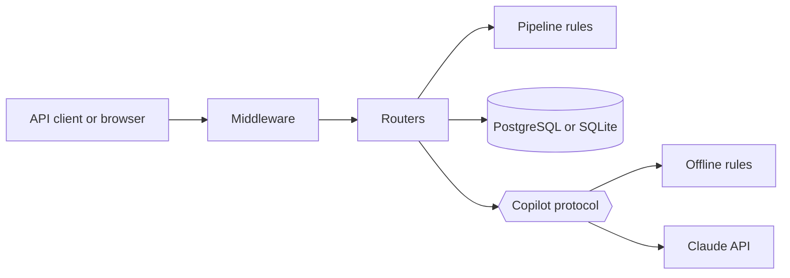

# How LeadPilot works

For how to use the API, see the [user guide](user-guide.md).

## Architecture

LeadPilot is a single FastAPI service in front of a relational database, with an optional
call to Claude.

| Folder | Role | Depends on |
| --- | --- | --- |
| `app/domain/` | Business rules | Nothing: plain Python |
| `app/ai/` | The copilot and what the model reads | Domain, models |
| `app/routers/` | HTTP endpoints | Everything above |
| `app/models.py` | Database tables | SQLAlchemy |
| `app/schemas.py` | What goes in and out of the API | Pydantic |
| `app/middleware.py` | Checks applied to every request | FastAPI |

## The life of a request

Take `POST /deals/1/stage`. Going through the layers from the outside in:

1. **CORS**, only if `CORS_ORIGINS` is set.
2. **Request ID**: reuses a harmless incoming `X-Request-ID` or creates one, then logs the
   method, path, status and duration.
3. **Security headers** are added to the response.
4. **Rate limit**, if enabled. Over the limit, the request stops here with a `429`.
5. **Body limit**: a body that is too large stops here with a `413`.
6. **FastAPI** matches the route and validates the input against a schema (`422` if invalid).
7. **The router** opens a database session for this request and loads the deal (`404` if missing).
8. **The domain** decides: `check_transition` accepts the move or raises an error with a reason.
9. **The router** commits and returns the deal as JSON.

Anything unexpected is caught at the very top: the traceback goes to the logs, and the client
gets a generic `500` with the request ID.
